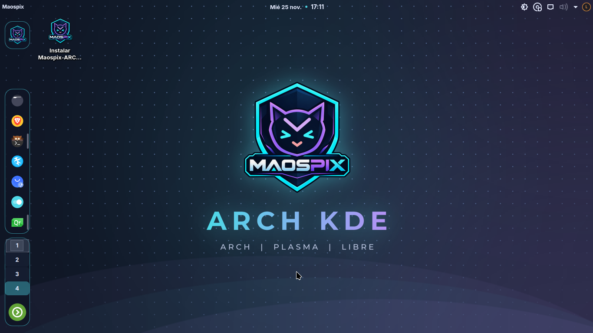
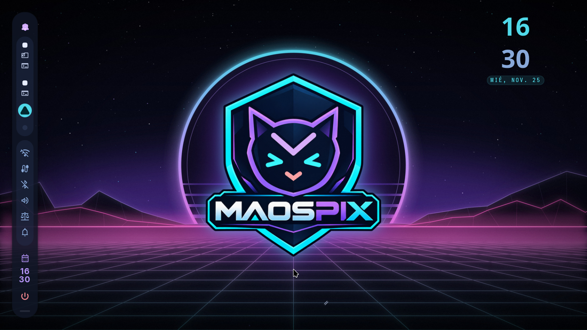
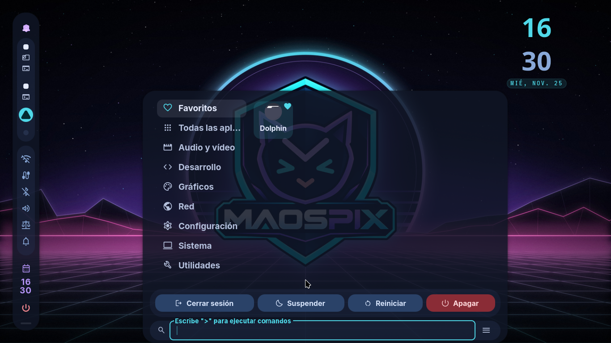
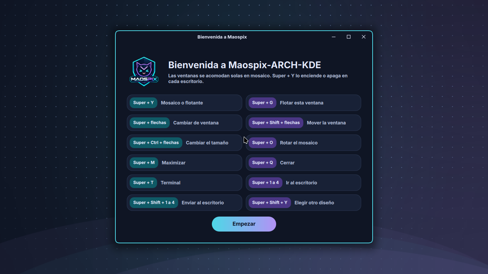
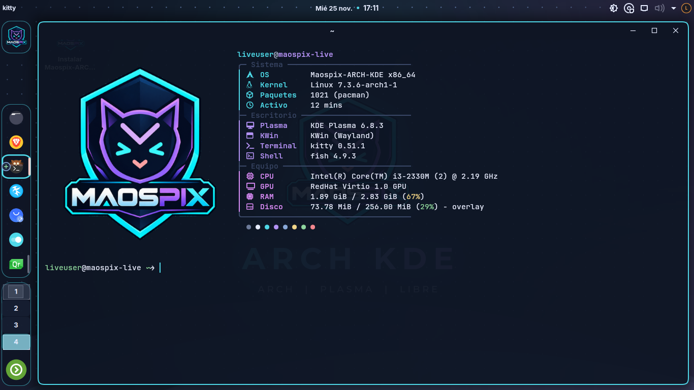
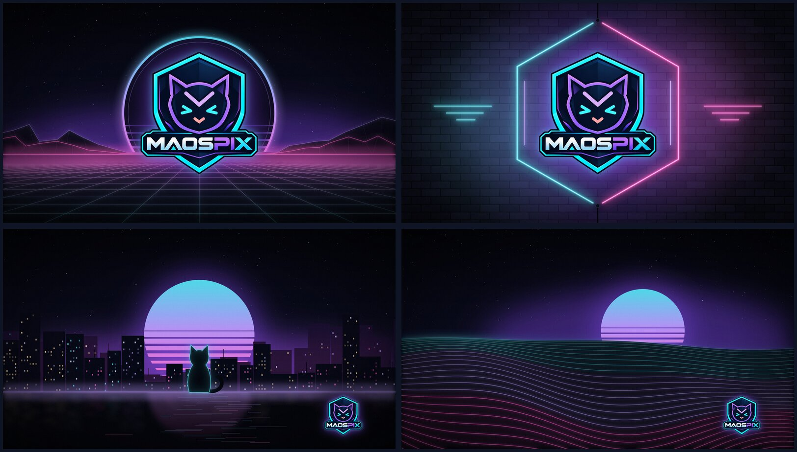

# Maospix-ARCH-KDE

Distro propia basada en **Arch Linux + KDE Plasma 6.8**, con el estilo de Garuda Mokka en los colores de Maospix (azul noche, cian y violeta), ventanas en mosaico al estilo COSMIC e instalador gráfico sin conexión. Parte de la familia maospix, creada por Marcos Olmedo (maospy), Itauguá, Paraguay.



## Dos estilos

- **Mokka** (por defecto): barra superior con islas, dock a la izquierda, íconos Tela Circle, Kvantum y Aurorae recoloreados.
- **Caelestia**: shell de [Caelestia](https://github.com/caelestia-kde/caelestia) con reloj grande y lanzador propio.

Se cambia desde el menú con **Estilo Mokka** / **Estilo Caelestia** (o `maospix-estilo mokka|caelestia`). El fondo y los atajos se conservan al ir y volver.





## Qué incluye

- **Mosaico automático** con [Krohnkite](https://codeberg.org/anametologin/Krohnkite): las ventanas se acomodan solas; Super+Y lo enciende o apaga en cada escritorio.
- **kitty** como terminal (Super+T) con **fish** y **fastfetch** con el logo del gatito. Konsole queda de respaldo.
- Botones de ventana a la derecha, como en Windows (— ▢ ✕).
- **yay**, **paru** y **base-devel** para el AUR; **Discover** con Flatpak.
- **Brave**, Dolphin, Kate, Okular, Gwenview, VLC, Ark, Spectacle.
- **Btrfs con snapshots** (snapper + grub-btrfs), **zram**, Plymouth y SDDM tematizados.
- **Ayudante NVIDIA** (solo GPUs Turing / GTX 16 o más nuevas) y **cortafuegos gráfico** (ufw, apagado por defecto).
- Sesión limpia: al entrar no se reabren las ventanas ni las pestañas de Dolphin.
- Cuatro fondos neón retro propios, además de los clásicos.







## Atajos principales

| Atajo | Acción |
|---|---|
| Super + T | Terminal |
| Super + Y | Mosaico o flotante |
| Super + G | Flotar esta ventana |
| Super + flechas | Cambiar de ventana |
| Super + Shift + flechas | Mover la ventana |
| Super + Ctrl + flechas | Cambiar el tamaño |
| Super + M | Maximizar |
| Super + Q | Cerrar |
| Super + 1 a 4 | Ir al escritorio |
| Super + Shift + 1 a 4 | Enviar al escritorio |

## Instalar

1. Descargá la ISO (3,3 GB) desde [SourceForge](https://sourceforge.net/projects/maospy-kde/files/maospix-arch-kde-2026.11.25-x86_64.iso/download) y verificá el checksum:

```
sha256sum maospix-arch-kde-2026.11.25-x86_64.iso
1b40841f188d6e6114d1b2bb5411963fc8bda297834135e9ff14ae5c7bc2c609
```

2. Grabala en un pendrive (Ventoy, `dd` o Balena Etcher). Arranca en **BIOS y UEFI**.
3. En el live abrí "Instalar Maospix-ARCH-KDE". No necesita internet.

Requisitos: 4 GB de RAM o más y 30 GB de disco.

**Si venís de Maospix-KDE (Nord):** esta versión no se actualiza encima de la anterior; hay que reinstalar. La versión vieja queda en la rama [`nord-v1`](../../tree/nord-v1) y la etiqueta `v1.0`.

## Construir la ISO

Requiere Arch Linux con `archiso`, `arch-install-scripts` y subuid/subgid configurados. No hace falta root.

```
git clone https://github.com/maospy/Maospix-ARCH-KDE
cd Maospix-ARCH-KDE
./tools/crear-chroot.sh        # entorno aislado para compilar
./tools/build-packages.sh      # paquetes propios y de AUR -> repo/x86_64
./tools/build-iso.sh 1         # ISO en out/
./tools/progreso.sh            # avance (en otra terminal)
```

## Estructura

- `archiso/`: perfil archiso (lista de paquetes, instalador Calamares, live).
- `packages/`: PKGBUILD de los paquetes propios (`maospix-arch-kde-theme`, `maospix-arch-kde-settings`, `maospix-plymouth-theme`) y de los de AUR.
- `tools/`: construcción, pruebas en QEMU y generadores (fondos, botones, recoloreado de Mokka).
- `upstream/UPSTREAM.lock`: versiones exactas de los proyectos externos.

## Créditos y licencia

[GPL-3.0](LICENSE). Basado en el trabajo de Garuda Linux (Mokka), Catppuccin, Krohnkite, Caelestia, Tela Circle y otros: ver [THIRD_PARTY.md](THIRD_PARTY.md). Cada componente conserva su licencia original.
